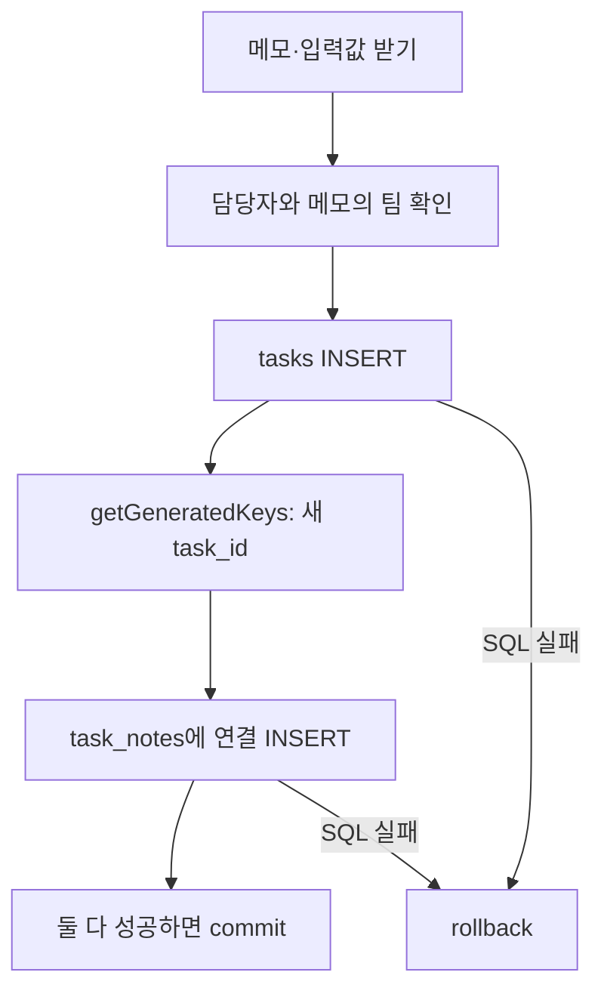

# 윤*훈 — 업무 CRUD·보드·메모 연결 브리핑

담당은 task 패키지의 TaskDAO, TaskFrame, TaskBoardPanel, TaskCardRenderer, TaskFromNoteDialog입니다. 기존 CRUD와 진행률 연결을 유지하고, **같은 tasks 데이터를 표·보드·내 업무로 다르게 보여주는 기능**을 추가했습니다.

## 먼저 이해할 객체

| 객체 | 사용 위치 | 담는 값 |
|---|---|---|
| TaskDAO.Assignee | 담당자 JComboBox | userId·이름, toString은 이름 표시 |
| TaskDAO.TaskInfo | 등록·수정 입력창 | 업무 번호·제목·설명·담당자·상태·마감일 |
| TaskDAO.Card | 업무 보드 | 번호·담당자·이름·상태·마감일 |
| DefaultTableModel | 기존 표 화면 | 업무 5개 기본 열과 진행률 패널이 붙인 마감 안내 열 |

DTO를 따로 둔 이유는 화면 부품 자체를 DAO에 전달하는 부분을 줄이고, 한 건의 입력·조회 결과를 묶기 위해서입니다. 기존 loadTasks는 수업 방식대로 표 모델을 받아 채우는 구조를 유지합니다.

## 기존 TaskFrame의 흐름

생성자: conn·teamId 저장→표 생성→더블클릭 이벤트→등록·수정·삭제·완료 버튼→초기 조회→InlineProgressPanel 연결→표 변경 시 fitColumns 예약.

- `getSelectedTaskId`: 선택한 행의 첫 열에서 task_id를 읽습니다. 선택이 없으면 -1입니다.
- `registerTask`: 입력창→필수 값·날짜 검사→insertTask→reload.
- `updateTask`: 선택 ID→findTask로 최신 상세 조회→입력창→updateTask→영향 행 확인→reload.
- `deleteTask`: 선택→삭제 확인→deleteTask→결과 안내→reload.
- `completeTask`: 선택→상태를 완료로 UPDATE→reload.
- `showTaskInputDialog`: 등록·수정이 공유하는 입력창. 날짜는 LocalDate.parse로 해석하고 잘못된 값은 안내 후 반복합니다.
- `reload`: 현재 팀 목록을 채운 뒤 진행률 패널도 갱신합니다.
- `fitColumns`: 각 열에서 제목과 모든 행의 너비 중 최대값을 찾아 여백을 더합니다. 열 c개·행 n개면 대략 O(c×n) 비교입니다.
- 원본 메모 버튼: 선택 ID→sourceNote→읽기 전용 창.

더블클릭으로 여는 MemberFrame에는 같은 teamId를 넘깁니다. 해당 별도 창은 DISPOSE_ON_CLOSE이므로 통합 프로그램을 종료하지 않습니다.

## SQL과 팀별 분리

loadTasks/showTasks의 `WHERE t.team_id=?`가 목록을 제한합니다. findTask·updateTask·updateTaskStatus·deleteTask는 task_id만 확인하지 않고 team_id도 확인합니다. 등록·수정은 requireTeamMember로 담당자가 같은 팀인지 확인합니다.

updateTask에서 setString/setInt 순서는 SQL의 `SET` 항목 다음 `WHERE task_id`, `WHERE team_id` 순서입니다. 메서드 인수 순서와 SQL 인수 순서가 항상 같지는 않으므로 직접 대응표를 적어 보세요.

`STATUS_LIST`는 상태 이름의 한 기준입니다. 보드와 진행률에서 '완료' 표기가 달라지면 분류·집계가 어긋납니다. DB 상태를 새 문자열로 늘릴 때 화면과 집계도 함께 검토해야 합니다.

## 상태별 보드·내 업무

`TaskBoardPanel`은 세 DefaultListModel과 세 JList를 가집니다. 기존 tasks를 복사한 별도 보드 테이블을 만들지 않습니다.

`reload → TaskDAO.board → 각 모델 clear → Card마다 STATUS_LIST와 비교 → 일치하는 칸에 addElement`.

상태 종류가 3개로 고정되어 n개 업무에 약 3n회 비교하므로 O(n)입니다. 조회는 마감일·업무 ID 순입니다. 같은 데이터이므로 보드에서 상태를 바꾼 뒤 표나 진행률 탭을 열면 변경이 반영됩니다.

내 업무 필터 SQL:

```sql
WHERE t.team_id=? AND (?=0 OR t.assignee_id=?)
```

mine=false면 두 번째 값 0: 앞 조건이 참이어서 팀 전체 조회. mine=true면 1: 앞 조건이 거짓이므로 세 번째 인수인 로그인 userId와 일치하는 업무만 조회. 담당자 이름이 아닌 번호로 비교합니다.

`move`는 선택한 카드의 id로 기존 updateTaskStatus를 호출합니다. 상태 이동은 버튼 방식입니다. 드래그 앤 드롭을 구현했다고 설명하지 마세요.

## TaskCardRenderer: 화면과 데이터 구분

ListCellRenderer는 JList의 한 데이터를 어떻게 그릴지 정하는 인터페이스입니다. getListCellRendererComponent가 Card를 받아 제목·담당자·날짜 JLabel에 넣고 JPanel을 반환합니다. 선택 여부에 따라 배경·글자색만 바꿉니다. 여기서 SQL을 실행하거나 상태를 수정하지 않습니다. 같은 렌더러 객체를 여러 항목을 그릴 때 재사용할 수 있습니다.

## 메모에서 업무를 만드는 알고리즘

이*찬의 NotePanel이 선택한 Note를 `TaskFromNoteDialog.open`에 넘깁니다. 제목은 메모 제목을 초기값으로 쓰고, 담당자는 현재 팀 목록, 마감일은 사용자가 입력합니다.



업무만 생기고 연결이 빠진 상태를 막기 위해 트랜잭션으로 묶습니다. note_id는 원문을 찾는 연결 키입니다. 생성 당시 메모 내용은 tasks.description에 복사되므로, 나중에 메모가 삭제되어도 만든 업무와 설명은 남습니다. sourceNote는 연결된 메모의 **현재** 내용을 보여줍니다.

## 브리핑과 확인

“보드는 기존 업무의 다른 보기입니다. 상태별로 데이터를 세 목록에 나누고, 내 업무 필터는 로그인 회원 번호로 SQL 조건을 바꿉니다. 메모에서 업무를 만들 때 생성 키로 연결 표를 저장하고 두 INSERT를 한 트랜잭션으로 묶었습니다.”

예측 문제: 팀7 업무3건 중 회원30이2건이면 내 업무 표시 개수는? 완료 상태로 바꾸면 새 행이 생기는가? 원문 메모를 삭제하면 업무도 없어지는가? 답은 2건, UPDATE라 새 행 없음, 업무는 남고 연결만 삭제입니다.
