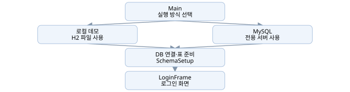

# 장*민 · DB와 공통 처리
원래 담당: DB·공통 시스템 / 추가: 데모 준비·공통 기록

내 역할: 프로그램이 사용할 저장소를 준비하고, 로그인한 사람의 소속 팀과 공통 저장 기능을 제공합니다.

## 시작할 때의 흐름

## 소스를 읽는 순서

| 파일 | 시작부터 끝까지 하는 일 |
|---|---|
| Main | main에서 시작 → 실행 방식 선택 → 연결·표 준비 → 로그인 창 열기 |
| DB_connection | configure로 주소·계정 기억 → open으로 실제 연결 만들기 |
| SchemaSetup | 필요한 표 준비 → 첫 데모이면 계정·팀·예제 생성 → 저장 확정 |
| TeamDAO | 로그인 회원의 소속 팀 조회 → 사용자가 팀 선택 / 저장 전 소속 검사 |
| ActivityDAO | 메모·일정 등의 저장 기록 추가 / 현재 팀의 최근 30건 조회 |

## 이 값 세 개를 구분하세요

conn은 DB와 연결된 통로, userId는 사람 번호, teamId는 팀 번호입니다. demo1의 회원 번호는 10이고 팀 7 또는 42를 선택합니다. 화면마다 같은 팀 번호를 넘겨야 다른 팀 정보가 섞이지 않습니다.

## 왜 저장 확정과 취소가 필요한가요?

메모 본문·수정 이력·활동 기록을 묶어 처리합니다. 모두 성공하면 commit으로 확정하고, 하나라도 실패하면 rollback으로 이번 묶음을 취소합니다. 이를 트랜잭션(함께 저장하는 작업 단위)이라고 합니다.

## 브리핑 한 문장

“저는 DB 연결과 초기 준비를 맡았고, 로그인 회원의 소속을 확인해 선택한 팀 번호를 각 기능에 전달하도록 했습니다.”

[세부 메서드와 실제 코드 위치](../07_code_index.md)
