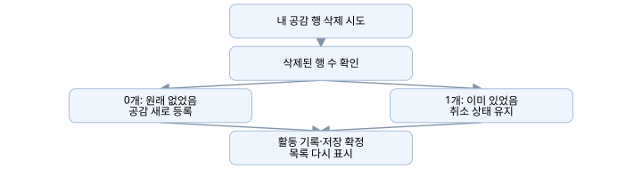

# 신*준 · 자료·아이디어·통합 화면
원래 담당: 자료·대시보드 / 추가: 댓글·공감·최근 활동 화면

내 역할: 각 기능을 탭으로 연결하고, 팀원이 자료와 아이디어를 올려 의견을 나누게 합니다.

## 소스를 읽는 순서

| 파일 | 화면 동작에서 저장까지 |
|---|---|
| MainFrame | 로그인한 사용자·팀 받기 → 9개 탭 만들기 → 선택한 탭 다시 읽기 |
| DashboardPanel | 진행률 계산값·업무·최근 자료 읽기 → 요약 화면 표시 |
| MaterialPanel → MaterialDAO | 자료명·주소 입력 → 현재 팀·작성자로 저장 → 목록 갱신 / 주소를 브라우저로 열기 |
| IdeaPanel → IdeaDAO | 아이디어 선택·입력 → 글·댓글·공감 처리 → 목록과 내용 다시 읽기 |
| IdeaCardRenderer / ActivityPanel | 아이디어를 카드처럼 표시 / 공통 기록 담당 코드에서 최근 활동을 받아 목록에 표시 |

## 공감 버튼을 누르면

## 화면 부품의 역할

JTabbedPane은 여러 화면을 고르는 탭, JList는 아이디어·최근 활동 목록, JTextField는 댓글 입력칸입니다. 렌더러는 목록의 한 항목을 카드로 그리는 코드입니다. 저장과는 역할이 다릅니다.

## 댓글·공감은 왜 별도 표일까요?

ideas는 글, idea_comments는 댓글, idea_reactions는 누가 공감했는지 저장합니다. 글 번호와 회원 번호를 함께 기본키로 정해 같은 사람의 중복 공감을 막습니다. 글 수정·삭제는 작성자 번호도 검사합니다.

## 갱신 중에 글을 바꾸어 골라도

5초 간격으로 목록을 다시 읽습니다. 조회 도중 사용자가 다른 글을 선택했다면 새 선택을 유지합니다. 댓글 입력칸은 자동으로 비우지 않습니다. 자료는 파일 자체가 아니라 주소를 저장합니다.

## 브리핑 한 문장

“화면 표시와 DB 처리를 나누고, 댓글·공감을 별도 표로 관리했습니다. 공감은 삭제된 행 수로 등록과 취소를 구분합니다.”

[세부 메서드와 실제 코드 위치](../07_code_index.md)
