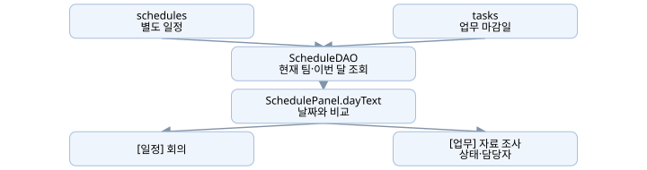

# 이*주 · 진행률·일정 달력
원래 담당: 일정·진행률 / 추가: 업무 마감일을 달력에 표시

내 역할: 완료 비율과 남은 날짜를 계산하고, 별도 일정과 업무 마감일을 같은 달력에 보여 줍니다.

## 달력 한 칸을 채우는 흐름

## 소스를 읽는 순서

| 파일 | 시작부터 끝까지 하는 일 |
|---|---|
| InlineProgressDAO | 현재 팀의 사람·업무를 읽어 계산에 필요한 값으로 묶기 |
| InlineProgressData | 전체·완료 개수 세기 → 비율 계산 / 마감일과 오늘 비교 |
| InlineProgressPanel | 계산 결과를 JProgressBar(진행 막대)와 마감 안내 글자로 표시 |
| ScheduleDAO | 별도 일정 조회·저장·삭제 / listDeadlines로 이번 달 업무 마감일 조회 |
| SchedulePanel | 달력 칸 만들기 → 날짜별 일정·업무 넣기 → 수정 후 또는 탭을 열 때 다시 읽기 |

## 계산 예제 두 개

업무 4개 중 완료 1개면 25%입니다. 전체가 0개면 나누지 않고 0%를 표시합니다. 10월 30일~11월 2일 일정은 두 기간이 겹치므로 11월에도 보입니다. 업무는 기간이 아니라 마감일 하루에 표시합니다.

## 달력을 그리는 기준

첫날이 목요일이면 월·화·수 3칸을 비웁니다. 그달 마지막 날까지 반복하며 날짜가 맞는 내용을 JTextArea(여러 줄 표시칸)에 넣습니다. 오늘은 배경색으로 구분합니다. 완료 업무도 “완료”라고 표시합니다.

## 업무는 따로 복사 저장하지 않습니다

업무 변경·삭제 후 달력 탭을 열거나 새로고침하면 원본 tasks를 다시 읽습니다. 따라서 예전 마감일에 중복된 일정이 남지 않습니다. 달력의 업무 수정은 업무 관리 화면에서 합니다.

## 브리핑 한 문장

“달력은 별도 일정과 업무 마감일을 각각 읽고, 날짜가 맞는 칸에 함께 표시합니다. 업무를 일정 표에 복사하지 않아 변경도 원본 기준으로 반영됩니다.”

[세부 메서드와 실제 코드 위치](../07_code_index.md)
