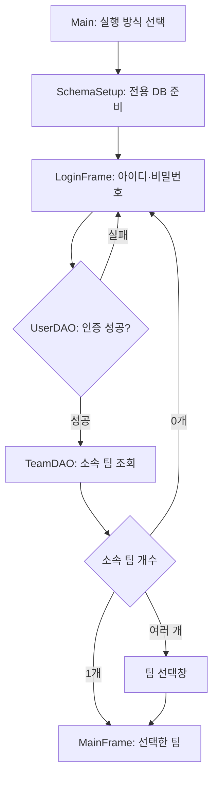
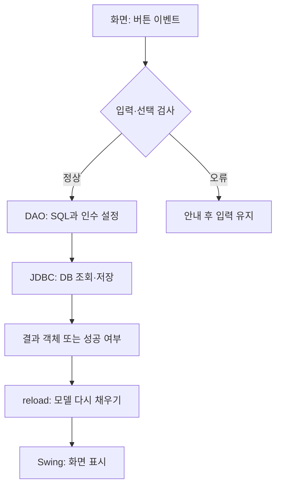
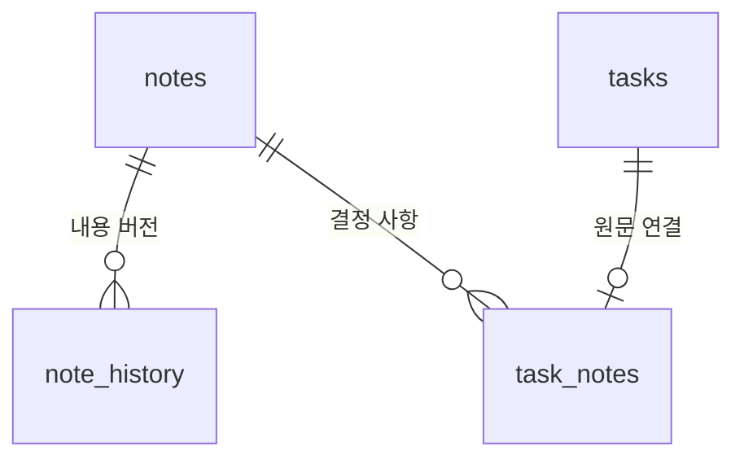
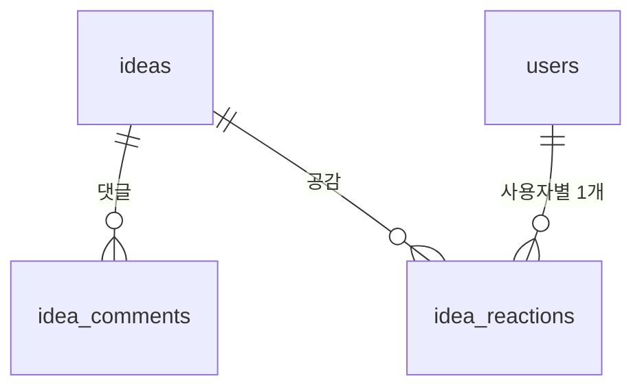

# 전체 흐름·모듈·자료구조

## 기존 버전과 확장 버전

저장소 루트의 `src`와 `db`가 기존 작성본입니다. `feedback-version`은 그 기반을 복사하고 변경·추가한 독립 프로젝트입니다. 패키지는 기존처럼 기능별 5개를 유지했습니다. 프로젝트 이름·데모 DB·진입점 실행 폴더가 별도이므로 같은 클래스 이름이 있어도 서로의 코드가 덮어써지지 않습니다.

## 시작과 로그인

실제 호출 순서: `Main.main → SwingUtilities.invokeLater → Main.start → SwingWorker.doInBackground → SchemaSetup.initialize → done → LoginFrame 생성자 → doLogin → UserDAO.login → TeamDAO.findTeams → MainFrame 생성자`.

로그인 결과의 `User.userId`는 사람 번호입니다. `Team.teamId`는 프로젝트 번호입니다. 회원 10이 팀 7·42에 모두 속할 수 있습니다. 팀 42를 선택하면 **모든 화면에 동일한 42**를 넘깁니다. 로그인에 성공했다는 사실만으로 소속 없는 팀을 자동 배정하지 않습니다.

## 버튼 한 번의 흐름

`Frame/Panel`은 입력과 표시, `DAO`는 SQL, DTO 내부 클래스는 데이터 한 건을 맡습니다. MVC 프레임워크를 추가하지 않고 이 세 역할만 구분했습니다. Connection은 일반 화면에서 하나를 전달하며, 자동 갱신만 별도 연결을 열어 읽고 닫습니다.

## 어떤 모듈을 왜 쓰는가

| 모듈·패키지/도구 | 사용 클래스 예 | 역할·선택 이유 |
|---|---|---|
| `java.base` | String, List, ArrayList, LocalDate, YearMonth, Path, InputStream | 문자열·목록·날짜·파일 읽기. JDK 기본 기능이므로 별도 설치 불필요 |
| `java.sql` | Connection, DriverManager, PreparedStatement, ResultSet, SQLException | JDBC의 공통 인터페이스. DB가 바뀌어도 DAO 구조를 유지 |
| `java.desktop`의 Swing | JFrame, JPanel, JButton, JTable, JList, Timer, SwingWorker | 수업에서 설명 가능한 데스크톱 화면·이벤트·갱신 |
| `java.awt` | BorderLayout, GridLayout, Desktop, Color | 화면 배치·색·브라우저 열기 |
| H2 JDBC 드라이버 | org.h2.Driver | 설치 없이 파일 DB로 시연, 메모리 DB로 테스트. 자바 표준 모듈이 아닌 외부 라이브러리 |
| MySQL Connector/J | com.mysql.cj.jdbc.Driver | 별도 MySQL 서버에 접속할 때 사용. JDK 자체가 MySQL 통신을 구현하지 않음 |

`src/module-info.java`의 `requires java.sql`, `requires java.desktop`은 위 JDK 모듈 사용 선언입니다. 기능별 `teamproject.member` 같은 **패키지**와 JPMS **모듈**, 외부 **JAR 라이브러리**를 같은 단어로 혼동하지 마세요.

## SQL을 읽는 규칙

- SELECT는 `executeQuery()` → ResultSet → while(next()) → 객체 목록 반환입니다.
- INSERT/UPDATE/DELETE는 `executeUpdate()` → 영향받은 행 수입니다. UPDATE 결과 0은 조건에 맞는 행이 없었다는 뜻입니다.
- `?`는 값을 넣는 자리입니다. SQL의 구조와 사용자 입력을 분리합니다. 첫 `?`는 1번부터 시작합니다.
- JOIN은 외래키로 연결된 표를 함께 읽습니다. 예: `updated_by=user_id`로 수정자의 이름을 얻습니다.
- 트랜잭션은 여러 SQL을 하나의 저장 단위로 묶습니다. `setAutoCommit(false) → 작업 → commit`, 실패하면 `rollback`, finally에서 true 복원입니다.
- `try (PreparedStatement ...; ResultSet ...)`는 사용이 끝난 쿼리 객체를 닫습니다. 전달받은 일반 Connection을 각 DAO가 닫으면 다른 화면도 끊기므로 닫지 않습니다. 자동 갱신용 Connection은 직접 열었으므로 그 작업이 닫습니다.

## 테이블 구조

프로그램이 읽는 스키마의 기준 파일은 `src/teamproject/common/schema.sql`입니다.

| 영역 | 테이블 | 핵심 관계 |
|---|---|---|
| 기존 사용자·팀 | users, teams, team_members | 사용자↔팀은 team_members로 다대다 연결 |
| 기존 업무·일정·자료 | tasks, schedules, materials | team_id로 프로젝트 소속, assignee_id·uploader_id로 사용자 연결 |
| 공유 메모 | notes, note_history | 메모 1개에 여러 버전. (note_id, version)이 이력의 복합키 |
| 메모→업무 | task_notes | 업무 1개에 연결 메모 1개. 메모 1개에서 업무 여러 개 생성 가능 |
| 아이디어 | ideas, idea_comments, idea_reactions | 게시물에 여러 댓글, 사용자당 공감 1개 |
| 공통 기록 | activity_log | 저장 시 팀·사용자·동작·시각 기록 |

notes 삭제 시 이력과 연결 행만 CASCADE 삭제됩니다. 이미 만든 tasks 행은 남습니다. ideas 삭제 시 댓글·공감은 CASCADE 삭제됩니다. `task_notes`는 복사한 원문 전체가 아니라 현재 메모로 연결합니다. 생성 당시 설명은 tasks.description에 복사되어 남고, '원본 메모' 버튼은 최신 메모 내용을 보여줍니다.

## 자동 갱신과 동시 편집은 별개

메모는 3초, 아이디어 목록은 5초마다 폴링합니다. Timer가 작업을 시작하고 SwingWorker가 별도 연결에서 SELECT합니다. 결과는 EDT의 done에서 화면에 반영합니다. Timer는 해당 탭이 보일 때만 조회하고, removeNotify에서 중지합니다. 로딩 중인 작업이 있으면 또 시작하지 않습니다.

목록 자동 갱신은 다른 사람이 쓴 내용을 보이게 하는 기능입니다. 동시 수정 충돌 방지는 별도로 notes.version을 비교합니다. 이 두 가지를 '글자 단위 실시간 공동 편집'이라고 설명하면 안 됩니다.

일반 저장 버튼·기존 조회는 단순한 동기 JDBC 호출입니다. 긴 원격 지연에서 모든 동작을 비동기로 처리하는 구조까지 도입하지 않았습니다. 자동 폴링과 시작 준비처럼 반복되거나 오래 걸릴 수 있는 작업에는 SwingWorker를 적용했습니다.
